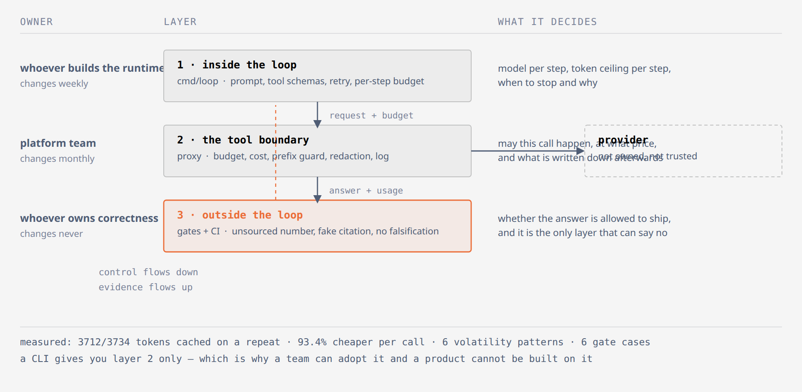

# agent-harness-lab

A small, offline-runnable harness for teams that use LLM agents in real work.
It exists to answer one question with evidence instead of opinion:

> Where does control actually live when your team uses an AI agent?

Most teams only get the middle layer: a CLI they cannot inspect, a bill they cannot
attribute, and no way to tell a good answer from a confident wrong one. This repo
builds the two layers a CLI cannot give you.

## The three layers

| Layer | Where it lives | What it buys you | In this repo |
|---|---|---|---|
| 1. Inside the loop | your own runtime | per-step budget, model choice per step, prefix stability | `runtime/` (phase 3) |
| 2. Tool boundary | a proxy | cost attribution, provider failover, redaction, prefix guard | `proxy/` (phase 1, done) |
| 3. Outside the loop | CI | truth: numbers must be sourced, schema must hold, gates must fire | `gates/` (phase 2) |

A CLI sits in layer 2 only. That is why a team can adopt it, but a product cannot
be built on it: cost and reproducibility live in layer 1.

## The shape of it

The figure answers one question: where control actually lives when a team uses an agent.



**Figure 1.** Each layer has a different owner and change rate: the loop decides what to ask, the proxy decides whether the call may happen and at what price, the gates decide whether the answer may be believed. Source: [`docs/figures/three-tiers.html`](docs/figures/three-tiers.html) — self-contained SVG, no remote assets.

## Quickstart (no API key, no network)

```bash
make test     # unit tests
make smoke    # end-to-end: cache reuse, prefix guard, budget stop
```

`make eval` runs the three gates against six cases: four must be rejected, two accepted.

`make demo-loop` starts the proxy and the layer-1 loop on top of it, then proves the
loop stops with a written reason instead of quietly overspending.

`make smoke` starts the proxy in fixture mode, sends the same request twice, then a
request with a date in the system prompt, then exhausts a tiny budget. Expected:

```
1st identical request   -> X-Harness-Cache-Read: 0
2nd identical request   -> X-Harness-Cache-Read: 13      (cache hit)
volatile head           -> X-Harness-Cache-Read: 0  +  X-Harness-Prefix-Warn: iso-date
exhausted budget        -> HTTP 429 with a JSON error, never a silent spend
```

## What the proxy enforces

- **Budget**: a hard daily token ceiling per environment. When it is gone, the answer
  is `429`, not a bigger invoice.
- **Prefix guard**: the head of a prompt is fingerprinted; dates, clock times, UUIDs,
  commit SHAs, unix timestamps and absolute paths inside the first 2000 bytes are
  reported, because each of them silently kills prompt caching from that point on.
- **Cost attribution**: fresh input, cached input and output are priced separately,
  written per request to `out/requests.jsonl`.
- **Redaction**: keys, emails and phone numbers are stripped before anything is logged.

## Cost per successful task

A wrong answer costs money, so the harness prices each task instead of each token.
13 questions about a real repository, an expectation regex written before the run, three
repair policies, 39 runs each:

| mode | success | cost per success |
|---|---|---|
| cheap only | 37/39 | $0.000197 |
| + same-tier retry on empty reply | 39/39 | $0.000180 |
| + strong-tier escalation | 39/39 | $0.000174 |

The strong tier was never needed, and the cheapest repair (retry on an empty reply)
fixed every failure it was spent on. Two of the findings are bugs in my own gate that
only appeared when the harness was actually run.

`make cost-eval-real` reruns it against the live provider; `make cost-eval` runs the same
plumbing offline. Details and limits: [docs/COST-PER-TASK.md](docs/COST-PER-TASK.md).

## Measured numbers (real provider, not a fixture)

- Repeat of a 3.7k-token prompt head: **3712 of 3734 tokens cached** on
  deepseek-v4.1-flash, **93.4% cheaper per call**; glm-5.3 78.7%; glm-5.3-flash 75.8%.
- Prepending one timestamp dropped cached tokens to **0** on all three models.

Method, prices and caveats: `docs/COST-MEASURED.md`.

## Design rules

1. Offline by default. CI never calls a model; it replays fixtures.
2. No secrets in the repo. Configuration is environment only.
3. Numbers are never generated by the model in a build path. The model may rank, the
   gate decides.
4. Every rule with a number in it must be provable by a command in this repo.

## Status

- Phase 1 (proxy: guard, budget, cost, redaction, request log): done
- Phase 2 (gates: unsourced number, fake citation, missing falsification section;
  eval runner with 6 accept/reject cases): done, `make eval`
- Phase 3 (minimal loop with step and total token ceilings, written stop reason): done,
  `make demo-loop`

## Licence

MIT
